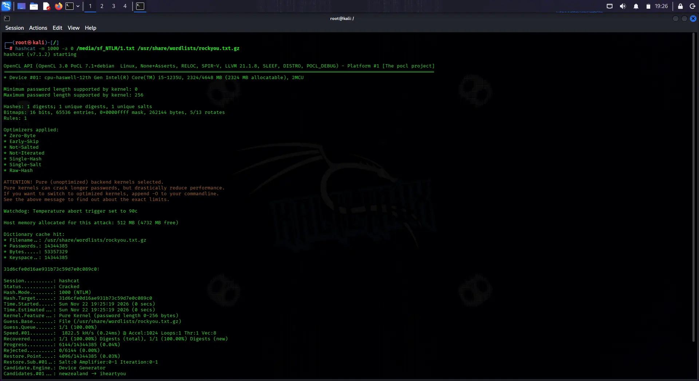

# Windows NTLM Hash Security Analysis

A defensive learning project exploring Windows NTLM password hashes, offline password-audit results, and the importance of protecting credential data.

## Objective

Understand why legacy NTLM hashes and weak passwords can create security risks, and how authorized password-strength auditing can help identify weak credentials in a controlled lab.

Only use synthetic test data or hashes from systems you own and are explicitly authorized to assess.

## Tools and Concepts

- **Kali Linux:** The environment shown in the terminal screenshot.
- **Hashcat:** A password-auditing tool that tests candidate values against supported hash formats.
- **NTLM:** A legacy Windows password-hash format.
- **Dictionary wordlist:** Candidate strings used during an authorized audit.

## Lab Summary

1. Prepare a controlled lab using synthetic or explicitly authorized test data.
2. Use a test NTLM digest for a password-strength audit.
3. Review the Hashcat result and record defensive lessons.

The screenshot shows Hashcat running in NTLM mode with dictionary input. It reports one digest and a final status of `Cracked`, with `1/1` recovered.

**Evidence limitation:** The screenshot documents the Hashcat result only. It does not show a `samdump2` command, SAM database extraction, or proof of where the input hash originated. This project does not claim that the screenshot proves those steps.

## Screenshot Evidence

The visible terminal output includes Hashcat version 7.1.2, hash mode `1000` (NTLM), a dictionary-based run using the `rockyou` wordlist, and one digest reported as recovered.

## Security Recommendations

- Never publish real NTLM hashes, SAM/SYSTEM files, recovered passwords, or personal account data.
- Conduct audits only with clear authorization.
- Treat a recovered password as compromised and change it on the test account.
- Use long, unique passwords and a password manager.
- Enable multi-factor authentication wherever available.
- Restrict access to credential stores and backups.
- Prefer modern authentication and security controls over legacy NTLM where feasible.

## What This Project Demonstrates

Weak passwords can be vulnerable to offline guessing if an attacker obtains a password hash. Password strength, secure credential storage, and access controls are therefore important.

---
An educational security project for defensive learning in an authorized lab.
